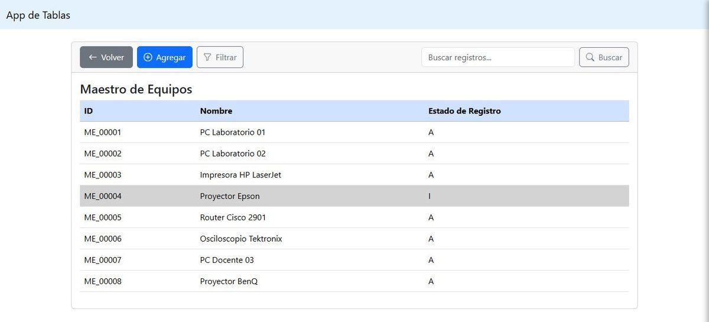
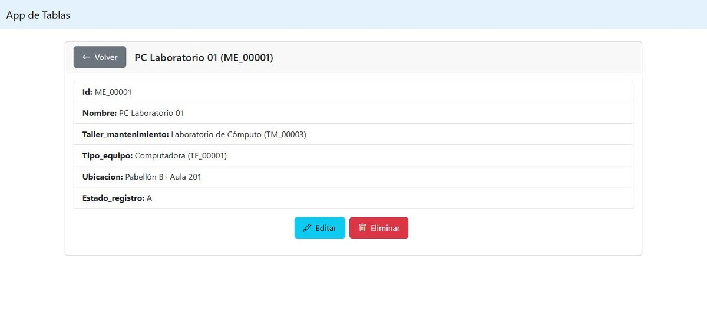
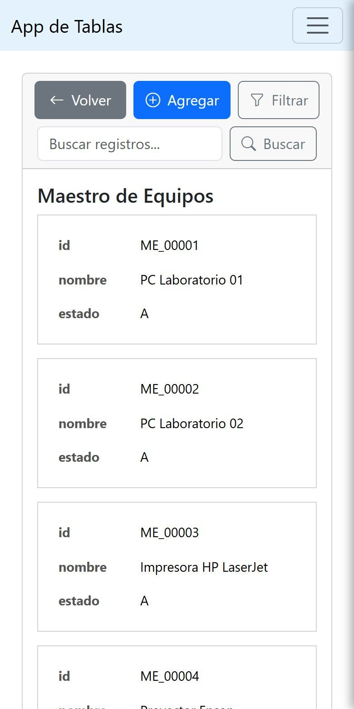

# Maestro de Equipos

Aplicación web en Django para llevar el inventario de equipos de laboratorio junto con dos tablas relacionadas: talleres de mantenimiento y tipos de equipo. La desarrollé por mi cuenta para un curso de la UNSA en diciembre de 2024.



## Qué hace

- Pide iniciar sesión para entrar a cualquier tabla.
- Lista, crea, edita y muestra el detalle de equipos, talleres y tipos.
- Busca por código, nombre o ubicación, y filtra por estado, taller y tipo de equipo.
- No borra registros de verdad: cada uno pasa por los estados activo, inactivo y eliminado.
- Genera los códigos solo, con un prefijo por tabla (`ME_00001`, `TM_…`, `TE_…`), mediante señales `pre_save`.
- Se puede instalar como app (PWA) y tiene una página para cuando no hay conexión.

Las tres tablas comparten las mismas vistas de listar, crear, editar y eliminar. La URL indica el modelo, por ejemplo `/maestro/crear/` o `/taller/editar/<id>/`.

<p>


</p>

En el celular la tabla se convierte en tarjetas. Las capturas usan datos de ejemplo.

## Tecnologías

Python con Django 3.2, MySQL a través de PyMySQL, Bootstrap 5 y django-pwa para el service worker.

## Ejecutarlo

Hace falta una base MySQL llamada `lab_ne`. El usuario y la contraseña se configuran en `DATABASES`, dentro de `lab_ne/settings.py`.

```
pip install -r requirements.txt
python manage.py migrate
python manage.py createsuperuser
python manage.py runserver
```

Después se entra en `http://127.0.0.1:8000/` con el usuario creado.
